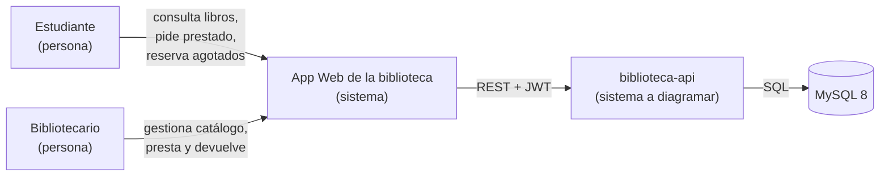
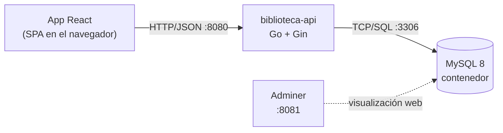
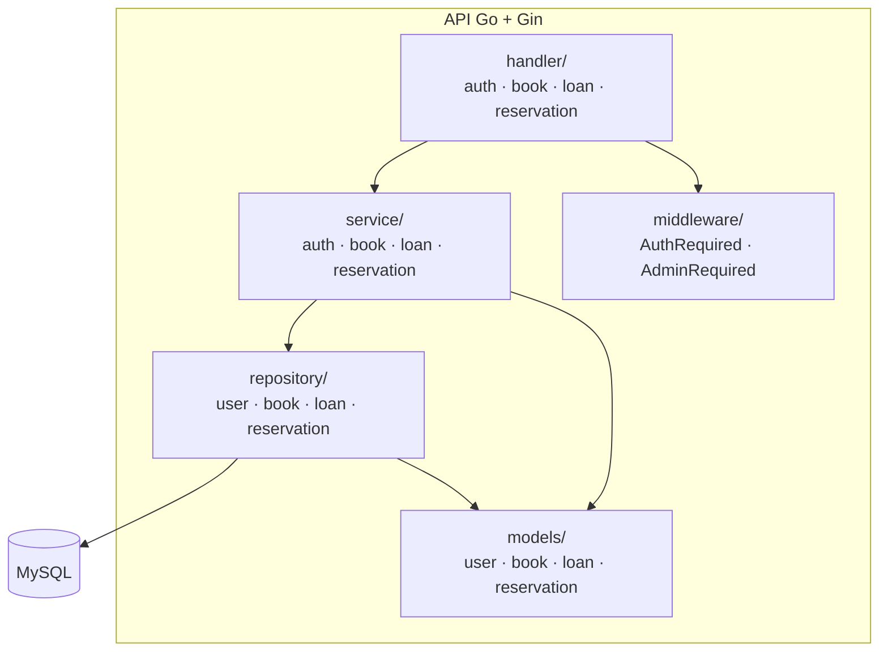
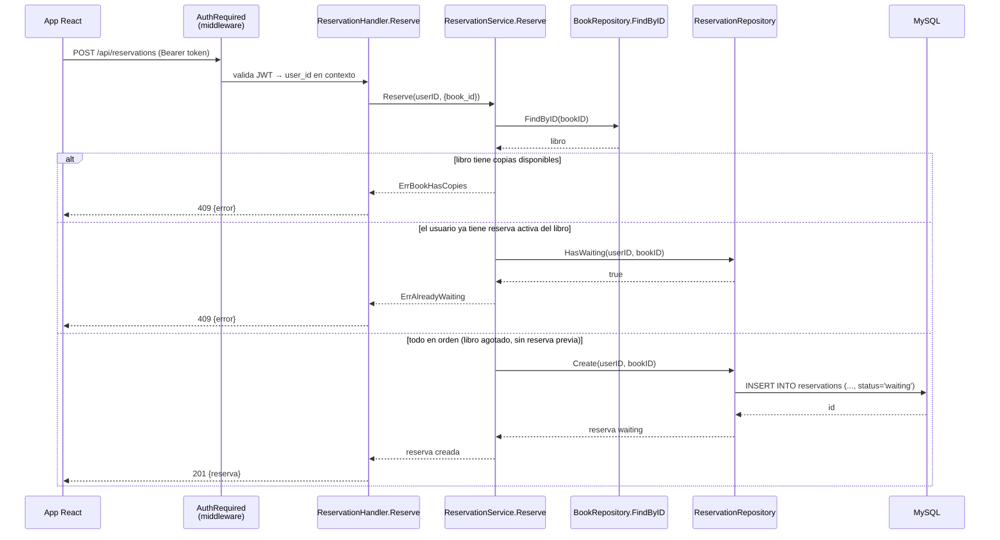
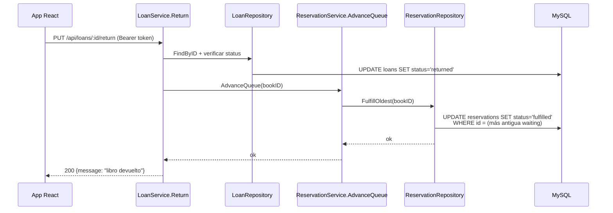

# Fase 5 — Diagramas (ejemplo resuelto)

*Proyecto de ejemplo · Feature dummy: **Reservas de libros** en `biblioteca-api`*

> Este documento es el **resultado** de la Fase 5 del proyecto de ejemplo. Muestra todos los diagramas que pide el enunciado (C4, componentes, secuencia), dibujados en **Mermaid**, coherentes con el ADR-001 (decisión: tabla nueva + módulo paralelo a `loans`).

---

## 1. C4 Nivel 1 — Contexto

**Pregunta:** ¿quiénes interactúan con el sistema y qué esperan de él?

**¿Qué muestra?** El sistema nuevo en el centro, sus actores humanos a la izquierda y el almacén (BD) a la derecha. Una sola pregunta; sin cajas de implementación como routers o handlers.

---

## 2. C4 Nivel 2 — Contenedores

**Pregunta:** ¿de qué bloques ejecutables está compuesta la API?

**¿Qué muestra?** Los bloques ejecutables reales (mismos de `docker-compose.yml`). Nota: la feature de reservas **no agregó contenedores** — vive dentro de la API y de MySQL.

---

## 3. Diagrama de componentes

**Pregunta:** ¿qué módulos internos tiene la API y dónde vive la feature nueva?

**¿Qué muestra?** La capa `reservation` **paralela** a `loan` dentro de cada paquete (handler/service/repository) — tal como decidió el ADR-001. No hay flechas de `loan` hacia `reservation` en el diagrama estático; la única conexión es el hook en `Return()` (se ve en la secuencia).

---

## 4. Diagrama de secuencia — Reservar un libro agotado

**Pregunta:** ¿qué ocurre, en orden, cuando un estudiante reserva?

**¿Qué muestra?** El flujo real con **las validaciones de negocio visibles** (copias disponibles y reserva duplicada): son los `alt` del diagrama, y corresponden una a una con los errores de `ReservationService`.

---

## 5. Diagrama de secuencia — La fila avanza al devolver

**Pregunta:** ¿cómo se entera la reserva de que hay una copia disponible?

**¿Qué muestra?** El **único punto de integración** con el módulo existente: al devolver, `LoanService` llama a una operación semántica (`AdvanceQueue`) sin conocer el esquema de reservas. Este diagrama justifica el hook que se implementó en la Fase 3.

---

## 6. Checklist de coherencia

- [ ] Contexto y Contenedores responden cada uno **una** pregunta.
- [ ] Componentes reflejan la decisión del ADR (módulo paralelo).
- [ ] Las secuencias muestran las **validaciones** (no solo el camino feliz).
- [ ] Los diagramas son **coherentes con el código** real (mismos nombres y endpoints).
- [ ] Todos los bloques Mermaid se renderizan en GitHub (pruébalo en tu fork).

> 📌 **Herramienta:** **Mermaid** (obligatoria) — se renderiza solo en archivos `.md` de GitHub. En tu proyecto, los diagramas van en `proyecto-final/diagramas.md` del fork.